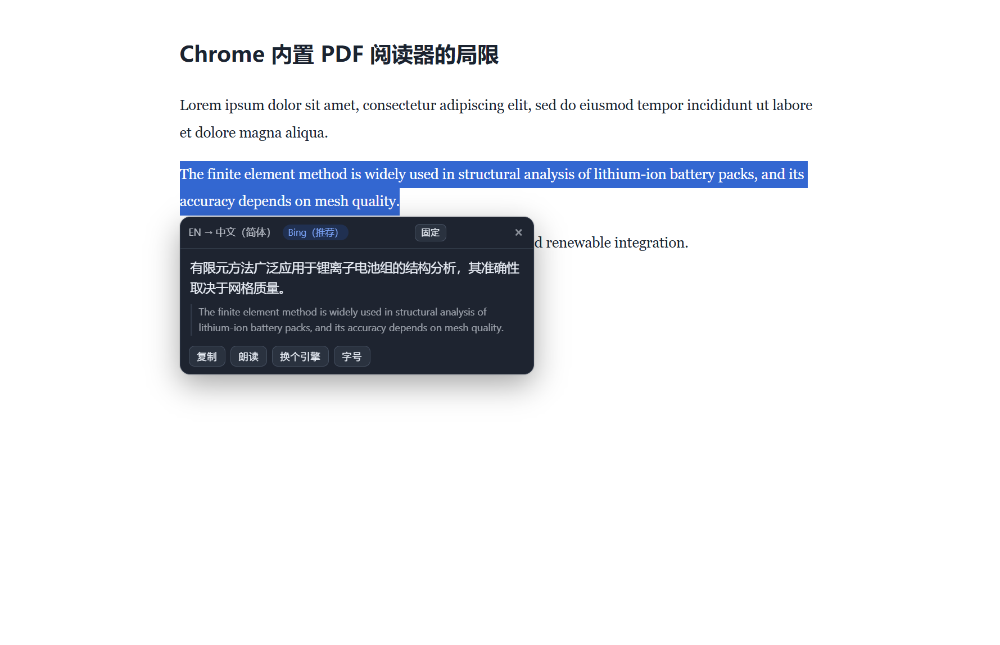

# 框选译 · PDF / 网页划词翻译（Chrome 扩展 v1.0.0）



框选即译的 Chrome 扩展。三种用法：

| 场景 | 操作 | 效果 |
|---|---|---|
| 普通网页 | 鼠标框选文字 | 选区下方弹出译文卡片，自动翻译 |
| **内置 PDF 阅读器**（本插件自带） | 框选 PDF 文字 | **同样自动弹出译文卡片** |
| Chrome 原生 PDF 阅读器 | 选中 → 右键「翻译选中文字」；或选中 → Ctrl+C | 译文进侧栏（需要先开侧栏）；或直接走剪贴板 |

> Chrome 自带的 PDF 阅读器是独立沙箱（`chrome-extension://mhjfb...`），任何扩展的网页脚本都进不去，
> 所以原生 PDF 里做不到「鼠标一框就自动弹卡」。要做到完全自动，用本插件自带的阅读器打开 PDF 即可（见下）。

## 安装（Chrome 只能手动加载一次，之后永久生效）

1. 打开 `chrome://extensions/`
2. 右上角打开「开发者模式」
3. 点「加载已解压的扩展程序」，选择本目录：
   `D:\XJTUpack\chat_dsh\tools\chrome-pdf-translate`
4. 点扩展图标旁的图钉，把它固定到工具栏

安装后第一次会打开设置页，点「翻译一句试试」确认网络通。

> 注意：这个目录就是插件本体，**不要删除或改名**，否则扩展失效（重新加载即可）。
> Chrome 重启后可能弹「请停用以开发者模式运行的扩展程序」，点 × 即可，不影响使用。

## 用内置阅读器读 PDF（推荐，框选即译）

- 右键 PDF 链接 / 正在阅读的 PDF 页面 → 「用「框选译」阅读器打开」
- 或点扩展图标 → 「用阅读器打开此 PDF」
- 或点扩展图标 → 「打开 PDF 阅读器」，再把本地 PDF 拖进窗口（或点「打开文件」）

阅读器支持：连续滚动、页码跳转、缩放、适应宽度、拖拽打开本地文件。
本地 `file://` PDF 若加载失败，在 `chrome://extensions` → 本扩展「详细信息」里打开「允许访问文件网址」，或直接拖文件进去。

## 设置项

- **触发方式**：选中即译 / 按住 Ctrl 才译 / 关闭（只想复制不想翻译时用 Ctrl 模式）
- **译文语言**：简中 / 繁中 / 英 / 日 / 韩 / 德 / 法 / 俄
- **引擎**：Bing（默认，国内可直连）/ MyMemory（备用）/ Google（需科学上网）
  主引擎失败会自动切到下一个，卡片上会标「已切换」
- **复制即翻译**：监听剪贴板，PDF 里选中后 Ctrl+C 自动翻译（默认开，只在 PDF/阅读器页生效）

## 更新记录

- **v1.0.10**：「朗读」改成读**原文**（原来是读译文，所以点下去念的是中文），并按原文语言挑对应音色（英文原文就用 en-US）。
- **v1.0.9**：缩放页面时，已弹出的译文卡片**在屏幕上保持原位**（按占视口比例还原，不再是缩放后跑到别处）。
- **v1.0.8**：「适应宽度」现在会先把浏览器缩放**回滚到 100%** 再按视口铺满（之前是以当前缩放比例的视野铺满，看起来像没还原），按钮点完百分比直接回到 100%。
- **v1.0.7**：缩放改成**以屏幕中心为中心**。点 −/+ 或按 Ctrl +/- 时，缩放前屏幕正中那段内容会留在正中（实测中心内容坐标前后完全一致），不再从左上角开始跳。
- **v1.0.6**：① 阅读器**框选偏移**修复——pdf.js 的隐藏文本层原来退回系统 serif 字体（字宽比内嵌字体宽 10%，被 scaleX 压扁），按字宽重排后现在用回 PDF 内嵌字体，偏差从 ~10% 降到 ~0.5%；② 译文框拖动范围放宽（可以拖到贴边/半出屏，留 80px 抓回来），拖完自动固定，不用再点按钮；③ 取消固定不再跳回选区，就停在原地；④ 打开非 PDF 链接时给出中文提示，不再是 pdf.js 的 Invalid PDF structure。
- **v1.0.5**：翻译卡片增强。① 译文卡片默认出现在**选区上方**（下方会挡住接着读的内容，上方放不下才回落）；② 新增**固定**按钮：点一下卡片就钉在原地，新译文原地替换，不再跟着选区跑，再点取消固定；③ 新增**字号**按钮：标准 → 大 → 特大 → 小，即时生效并记住；④ 卡片字号**不随页面缩放变化**（按 1/缩放 反向补偿，物理尺寸恒定）；⑤ 新增「网页上也自动翻译」开关，关掉后只有内置 PDF 阅读器会框选翻译。
- **v1.0.4**：缩放彻底对齐成「一个」。工具栏的 −/+ **直接控制 Chrome 页面缩放**，所以工具栏数字和 Chrome 自己弹出的缩放气泡永远相同（按 Ctrl +/- 也一样）；放大后不会再被「适应宽度」回弹。100% = PDF 实际尺寸（1pt=96/72px，A4 约 816px 宽）。「适应宽度」只调整文档铺满窗口，不改浏览器缩放。
- **v1.0.3**：顶栏改成**恒定尺寸**。页面缩放（Ctrl +/-、Ctrl+滚轮）只影响正文，顶栏的高度、字号、按钮大小、位置都保持不变，不会跟着放大撑高、挤走正文。做法是给顶栏按 1/浏览器缩放比例反向 zoom，正文留白随顶栏高度动态计算。
- **v1.0.2**：缩放打通。工具栏的百分比现在是**最终视觉比例**（= 阅读器内部比例 × Chrome 页面缩放），不再出现「Chrome 显示 110%、这里显示 260%、实际 286%」的三套数字。Ctrl +/- 或 Ctrl+滚轮缩放浏览器时，工具栏数字同步变化；处于「适应宽度」时会自动重新适应、不出横向滚动条。顺带修掉建完页后滚动条出现导致「适应宽度」偏宽十几像素的问题。
- **v1.0.1**：修复阅读器放大到超过窗口宽度后，横向滚动条拉到头也看不到左侧内容的问题（原 flex 居中导致左侧溢出到滚动原点之外）；「适应宽度」改为按可视区计算，不再顶出横向滚动条；缩放后横向自动回到页面中间。
- **v1.0.0**：首个版本。

## 常见问题

- **缩放对不上？** 从 v1.0.4 起两者是同一个值：工具栏的 −/+ 就是 Chrome 的页面缩放，Ctrl +/- 也直接让工具栏数字同步变化。
- **翻译失败**：设置页点「翻译一句试试」看引擎是否可用；点卡片上「换个引擎」。
- **原生 PDF 右键没菜单**：改用「Ctrl+C + 侧栏」或内置阅读器；Chrome 版本差异下右键菜单不一定出现。
- **侧栏没反应**：先切到一个网页/PDF 标签再点「打开侧栏」，新标签页/设置页不允许开侧栏。
- **卡片挡住了文字**：拖动卡片标题栏移动它；Esc 关闭。

## 目录结构

```
manifest.json          MV3 清单
background.js          服务：右键菜单、翻译调度、侧栏、剪贴板
lib/engines.js         翻译引擎（Bing 网页版 / MyMemory / Google）+ 缓存 + 自动降级
content/content.js     网页与阅读器里的划词 UI（Shadow DOM，不污染页面样式）
reader.html + reader/  内置 PDF 阅读器（pdf.js 4.10，含 cmaps/字体）
panel.html/js          侧栏：当前译文 + 历史
popup.html/js          工具栏弹窗：状态、快捷开关、入口
options.html/js        设置页
offscreen.html/js      剪贴板监听（MV3 offscreen 文档）
```

## 隐私

只把你**选中的文字**发给翻译服务；不采集浏览记录、不上报任何数据。
剪贴板监听仅在本机读取，只用于翻译你刚复制的内容。

## 回滚

`chrome://extensions/` → 找到「框选译」→ 移除。删除本目录即可彻底清除。
